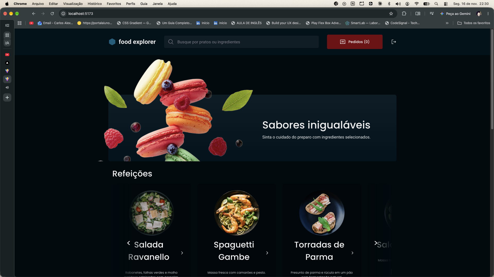
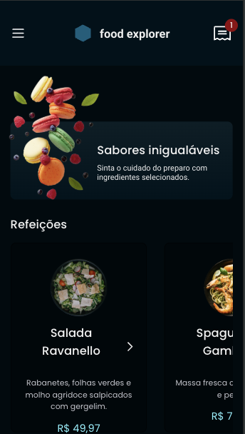
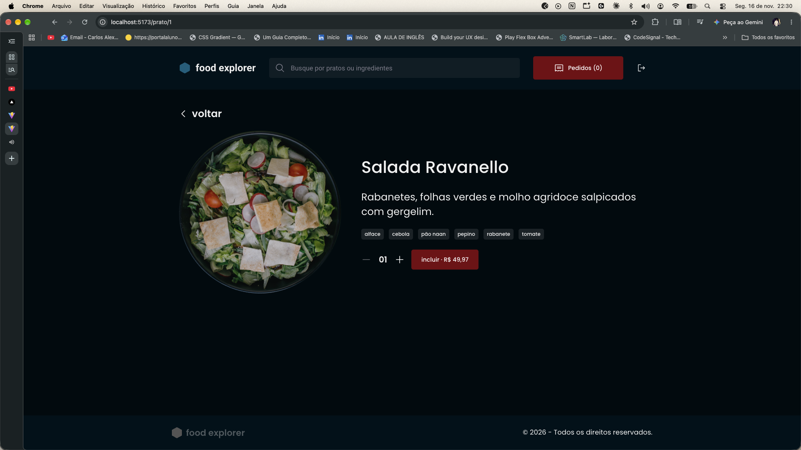
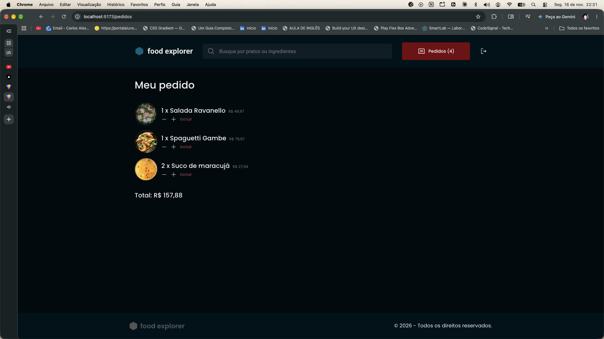

# Food Explorer

Cardápio digital de um restaurante, com carrinho de pedidos, feito com React. Projeto de estudo baseado no desafio **Food Explorer** da Rocketseat.

**Site no ar:** https://foodexplorer-liard.vercel.app/

## Telas

| Home (desktop) | Home (celular) |
| --- | --- |
|  |  |

| Prato | Pedidos |
| --- | --- |
|  |  |

## O que o projeto faz

- Home com banner e carrosséis de refeições, sobremesas e bebidas
- Página de detalhes do prato, com ingredientes e escolha de quantidade
- Carrinho com adicionar, aumentar, diminuir e excluir itens
- Contador de itens no cabeçalho e total do pedido calculado
- Layout responsivo, do celular ao desktop

## Tecnologias

- React 18 e Vite
- styled-components
- React Router
- Context API (estado global do carrinho)
- Phosphor Icons
- Deploy na Vercel

## Como rodar localmente

```bash
git clone https://github.com/Carlosalexandree/foodexplorer.git
cd foodexplorer
npm install
npm run dev
```

O projeto abre em `http://localhost:5173`.

## Próximos passos

- API em Node.js com banco de dados SQL (V2)
- Telas de login e cadastro
- Guardar o carrinho no navegador

## Autor

Carlos Alexandre
[GitHub](https://github.com/Carlosalexandree)